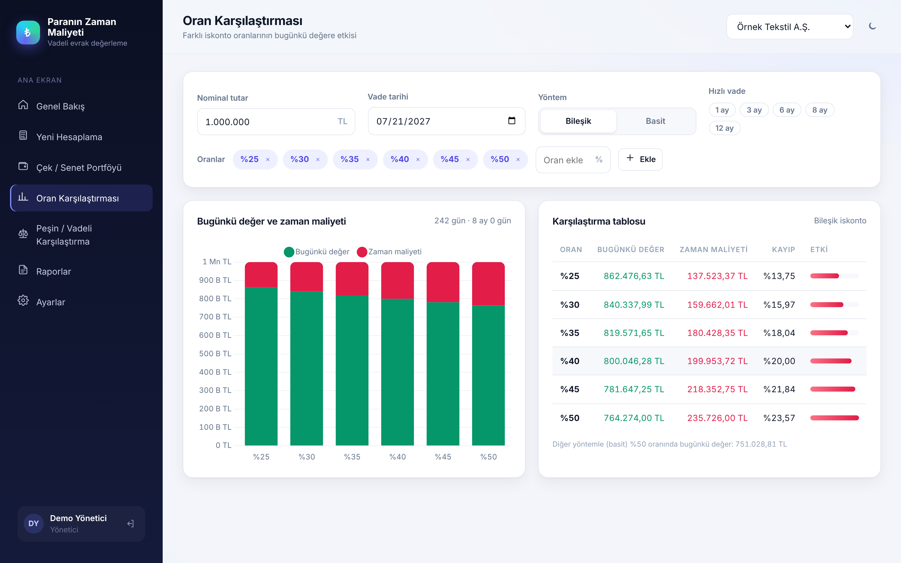
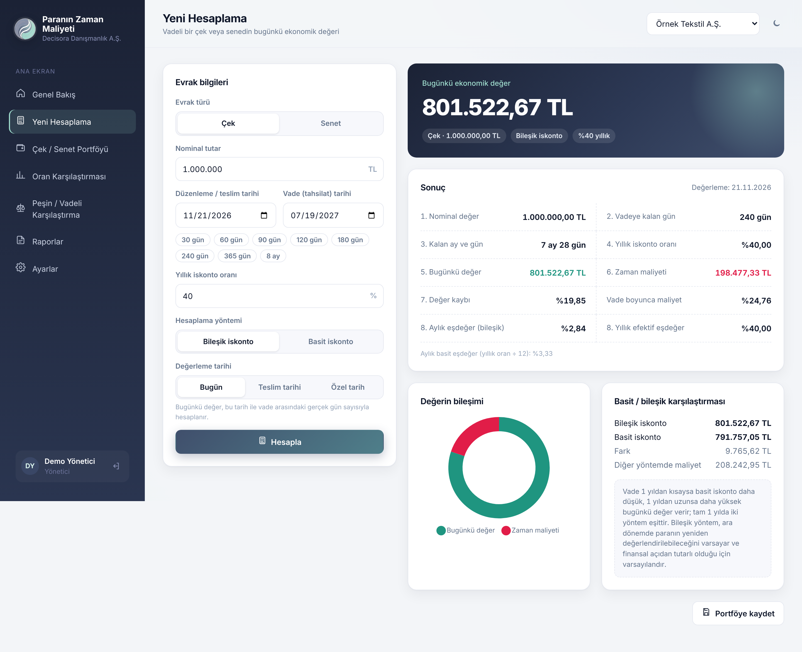
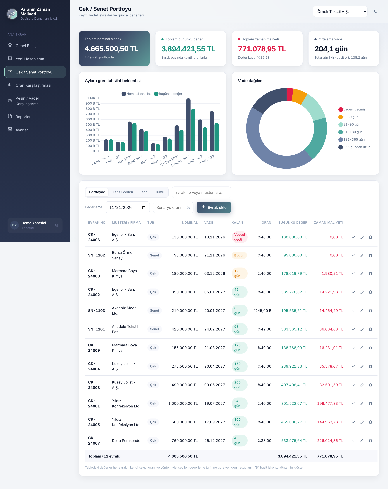
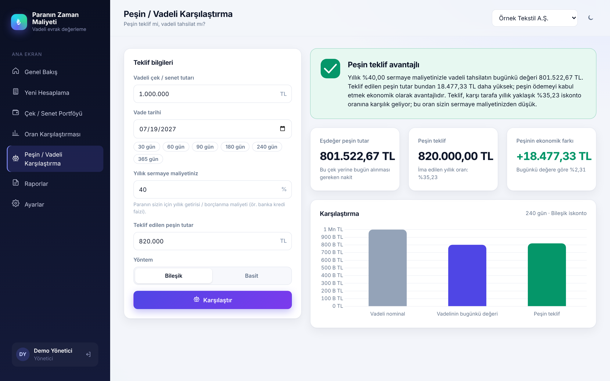
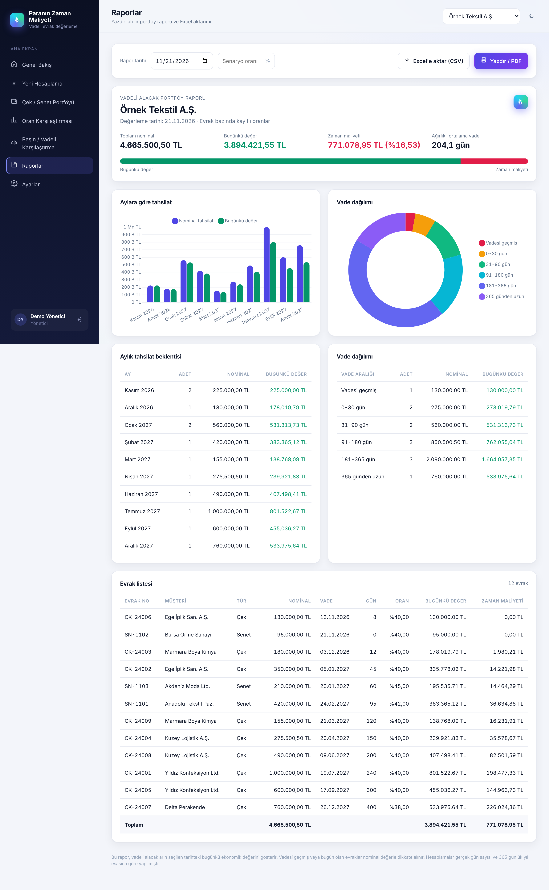

<p align="center"></p>

# Paranın Zaman Maliyeti

**Vadeli çek ve senet değerleme · Finansal karar destek sistemi**  
Geliştiren ve sahibi: **Decisora Danışmanlık A.Ş.**

> Gelecekte tahsil edeceğim belirli bir tutar, bugünün parasıyla gerçekte kaç TL değerindedir?

240 gün vadeli 1.000.000 TL'lik bir çek, yıllık %40 iskonto oranıyla bugün
**801.522,67 TL** eder. Aradaki **198.477,33 TL** paranın zaman maliyetidir.
Bu uygulama, işletmelerin vadeli alacaklarını nominal tutarları yerine bugünkü
ekonomik değerleriyle görmesini ve buna göre karar vermesini sağlar.



## Özellikler

- **Yeni hesaplama:** Çek / senet; bileşik (varsayılan) ve basit iskonto; bugün, teslim tarihi veya özel tarihe göre değerleme; bugünkü değer, zaman maliyeti, değer kaybı, kalan ay+gün, aylık ve yıllık eşdeğer oranlar.
- **Oran karşılaştırması:** İstediğiniz oranlarla tablo ve grafik.
- **Peşin / vadeli karşılaştırma:** Eşdeğer peşin tutar, ekonomik fark, ima edilen oran ve gerekçeli karar.
- **Portföy:** Çoklu evrak; toplam nominal, bugünkü değer, zaman maliyeti, ortalama vade, vade dağılımı, aylık tahsilat beklentisi; senaryo oranı.
- **Çoklu firma ve kullanıcı:** Danışmanın hizmet verdiği her firma için ayrı portföy; firma kullanıcıları yalnızca kendi firmalarını görür.
- **Raporlar:** Yazdırılabilir / PDF rapor, Excel'de açılan CSV aktarımı.
- **Modern arayüz:** Tamamen Türkçe, açık / koyu tema, masaüstü ve mobil uyumlu.
- **Finansal hassasiyet:** 40 haneli `Decimal` hesap, kuruş düzeyinde yuvarlama, gerçek gün sayısı.

| Yeni hesaplama | Portföy |
|---|---|
|  |  |
| **Peşin / vadeli** | **Rapor** |
|  |  |

## Hızlı başlangıç

**Windows (en kolay):** [Kur-ve-Calistir.bat](https://github.com/erkansinel/paranin-zaman-maliyet/raw/main/Kur-ve-Calistir.bat) dosyasını indirip çift tıklayın. GitHub'daki son sürümü indirir, gerekenleri kurar ve programı tarayıcıda açar; her açılışta kendini günceller. Ayrıntılar: [docs/06-kurulum-ve-yayin.md](docs/06-kurulum-ve-yayin.md#61-windows-tek-dosyayla-githubdan-indir-ve-çalıştır-en-kolay)

**Windows (internetsiz hazır paket):** `ParaninZamanMaliyeti-Windows.zip` dosyasını bir klasöre çıkarın ve **Baslat.bat**'a çift tıklayın. Ayrıntılar: [docs/06-kurulum-ve-yayin.md](docs/06-kurulum-ve-yayin.md#62-windows-çift-tıkla-çalışan-hazır-paket-internetsiz-kurulum)

**Kaynak koddan:**

```bash
pip install -r requirements.txt
python -m app.demo            # isteğe bağlı örnek veri (demo / demo1234)
uvicorn app.main:app --reload # http://localhost:8000
```

İnternette yayınlamak için: [docs/06-kurulum-ve-yayin.md](docs/06-kurulum-ve-yayin.md)

## Dokümantasyon

| Bölüm | İçerik |
|---|---|
| [1. Amaç ve kapsam](docs/01-amac-ve-kapsam.md) | Program neden yapıldı, kimler için, hangi kararları destekler |
| [2. Finansal yöntem](docs/02-finansal-yontem.md) | Tüm formüller, elle doğrulanabilir örnekler, yuvarlama ve doğrulama kuralları |
| [3. Mimari](docs/03-mimari.md) | Katmanlar, veri modeli, güvenlik, teknoloji seçimleri |
| [4. Kullanım kılavuzu](docs/04-kullanim-kilavuzu.md) | Ekran ekran kullanım |
| [5. Test ve doğrulama](docs/05-test-ve-dogrulama.md) | Şartnamedeki 7 test senaryosu ve sonuçları |
| [6. Kurulum ve yayın](docs/06-kurulum-ve-yayin.md) | Yerel kurulum, Render, Docker |
| [7. Yol haritası](docs/07-yol-haritasi.md) | Henüz olmayan özellikler ve nasıl eklenecekleri |

## Testler

```bash
pip install -r requirements-dev.txt
pytest -q      # 44 test
```

## Teknoloji

Python · FastAPI · SQLAlchemy · SQLite / PostgreSQL · Alpine.js · Chart.js
