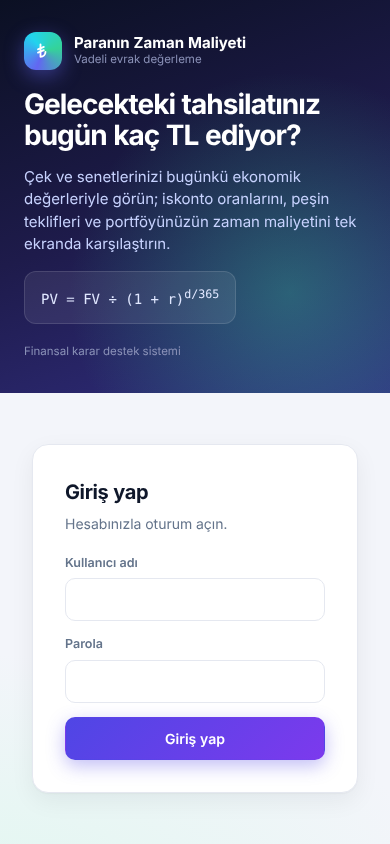
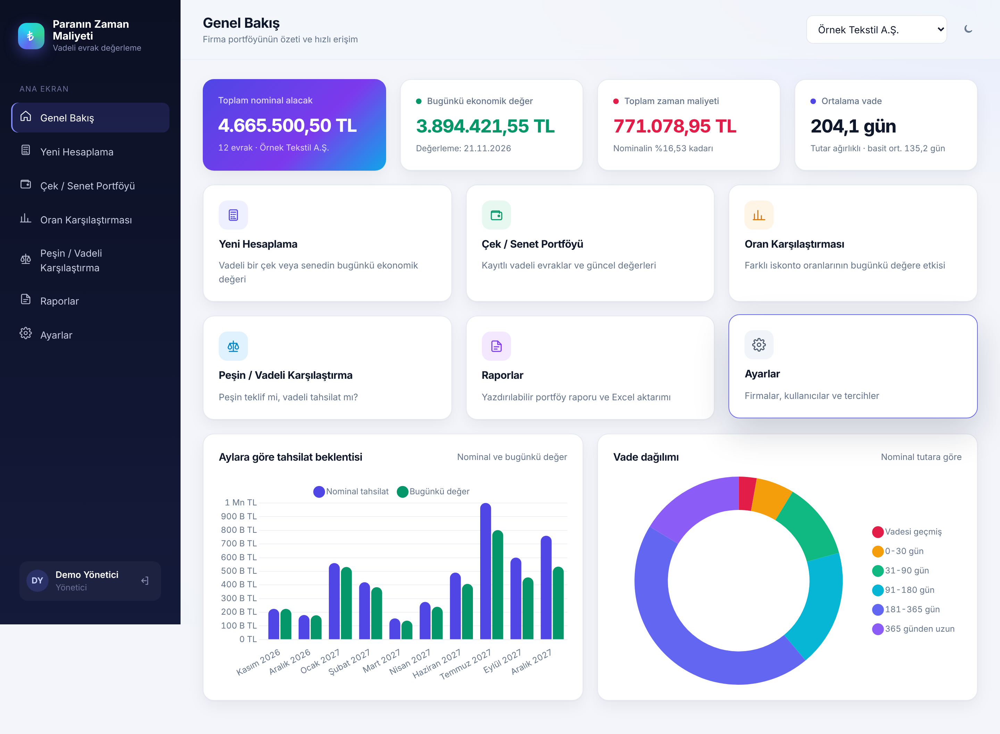
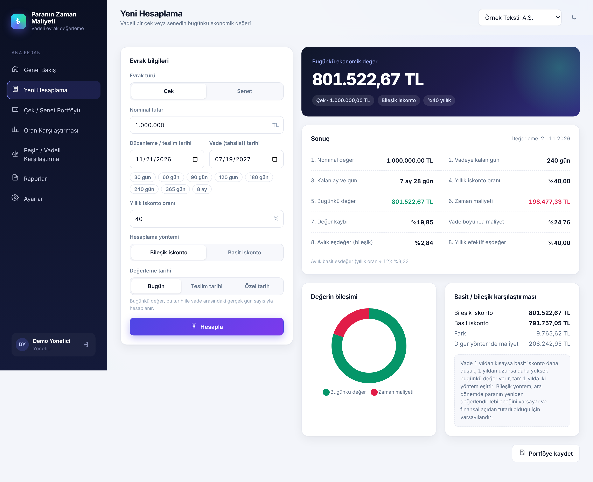
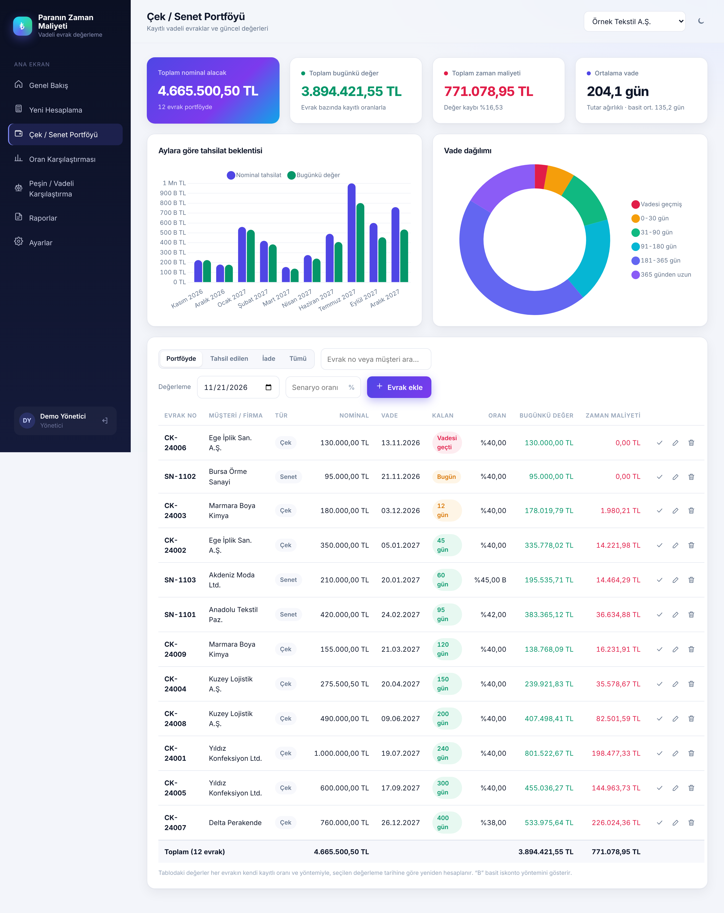
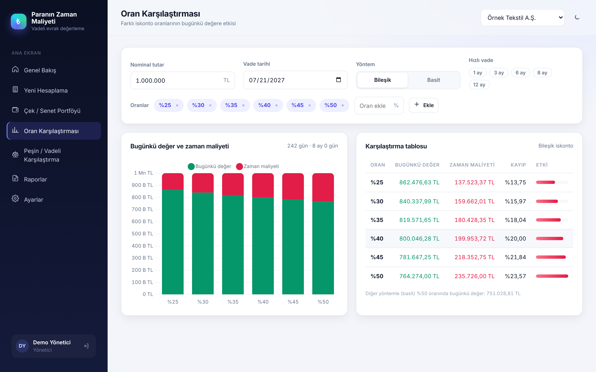
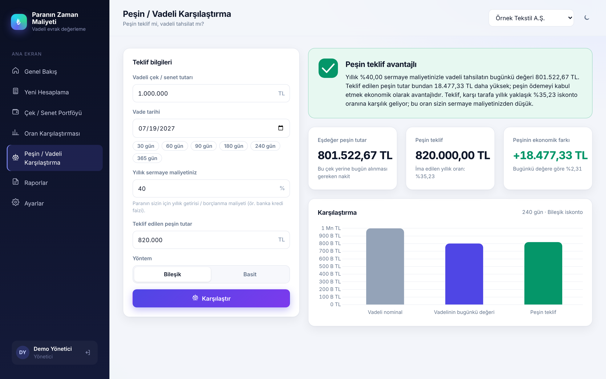
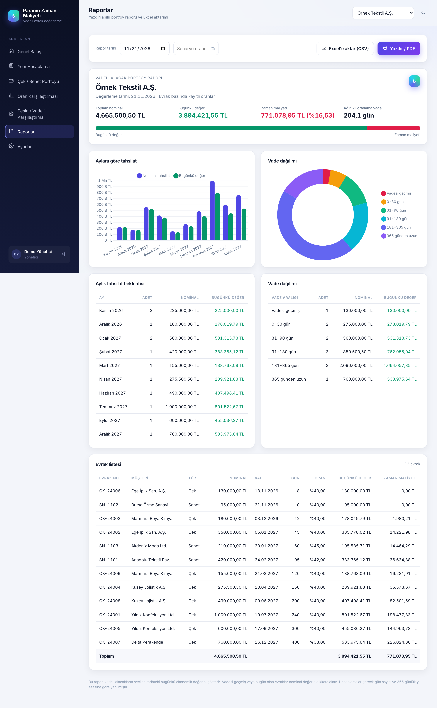
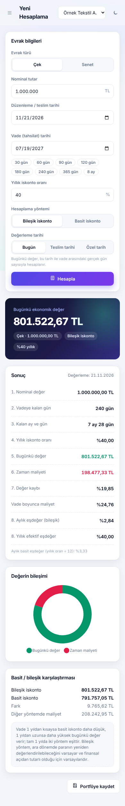

# 4. Kullanım Kılavuzu

## 4.1 İlk kurulum ve giriş

Uygulama ilk kez açıldığında **İlk kurulum** ekranı gelir. Burada yönetici
hesabı (ad soyad, kullanıcı adı, parola) ve isteğe bağlı olarak ilk firma
oluşturulur. Sunucuda `PZM_KURULUM_ANAHTARI` tanımlıysa bu anahtar da istenir.

Sonraki açılışlarda **Giriş yap** ekranı gelir.

Üst çubuktaki açılır listeden çalışılacak **firma** seçilir. Portföy, raporlar
ve varsayılan oranlar seçili firmaya göre değişir. Sağ üstteki ay/güneş
simgesiyle açık / koyu tema arasında geçilir.

## 4.2 Genel Bakış

Seçili firmanın toplam nominal alacağı, bugünkü ekonomik değeri, toplam
zaman maliyeti ve ortalama vadesi; aylara göre tahsilat ve vade dağılımı
grafikleri ile diğer ekranlara hızlı erişim kutucukları.

## 4.3 Yeni Hesaplama

1. Evrak türünü (Çek / Senet) seçin.
2. Nominal tutarı girin. `1.000.000`, `1.000.000,50` veya `1000000.50` yazılabilir.
3. Düzenleme / teslim tarihini ve vade tarihini girin. Hızlı düğmeler
   (30 gün … 365 gün, 8 ay) vade tarihini otomatik doldurur.
4. Yıllık iskonto oranını girin (varsayılan, firmanın ayarındaki orandır).
5. Yöntemi seçin (varsayılan bileşik).
6. Değerleme tarihini seçin: **Bugün**, **Teslim tarihi** veya **Özel tarih**.
7. **Hesapla**.

Sonuçta şartnamedeki 8 gösterge, değerin bileşimi grafiği ve basit / bileşik
karşılaştırması görünür. **Portföye kaydet** ile evrak numarası ve müşteri
adı eklenerek portföye kaydedilir.

## 4.4 Çek / Senet Portföyü

* Üstte dört özet kartı, ardından aylık tahsilat ve vade dağılımı grafikleri.
* Listede: **Portföyde / Tahsil edilen / İade / Tümü** filtreleri ve arama.
* **Değerleme** tarihi değiştirilerek portföyün geçmiş veya gelecek bir tarihteki değeri görülebilir.
* **Senaryo oranı** girilirse tüm portföy o tek oranla yeniden değerlenir.
* Satır sonundaki simgeler: ✓ tahsil edildi, ✎ düzenle, 🗑 sil.
* Kalan gün etiketi: yeşil (30 günden uzun), turuncu (30 gün ve altı / bugün), kırmızı (vadesi geçmiş).

## 4.5 Oran Karşılaştırması

Nominal tutar ve vade girilir; varsayılan %25-%50 arası oranlar otomatik
hesaplanır. Oran çipindeki × ile oran çıkarılır, "Oran ekle" ile yenisi eklenir.
Grafik her oranda bugünkü değer (yeşil) ve zaman maliyetini (kırmızı) üst üste
gösterir; tabloda her satırın etkisi çubukla görselleştirilir.

## 4.6 Peşin / Vadeli Karşılaştırma

Vadeli tutar, vade tarihi, **kendi yıllık sermaye maliyetiniz** ve teklif edilen
peşin tutar girilir. Program:

* **Eşdeğer peşin tutarı** (bu çek yerine bugün almanız gereken nakit),
* peşin teklifin bu tutara göre **ekonomik farkını**,
* teklifin karşı tarafa hangi **yıllık iskonto oranına** denk geldiğini,
* ve kararı gerekçesiyle Türkçe olarak gösterir.

## 4.7 Raporlar

Seçili firmanın portföy raporu: özet göstergeler, bugünkü değer / zaman
maliyeti oranı çubuğu, grafikler, aylık tahsilat ve vade dağılımı tabloları,
evrak listesi.

* **Yazdır / PDF**: Tarayıcının yazdırma penceresi açılır; menüler gizlenir,
  yalnızca rapor yazdırılır. "PDF olarak kaydet" seçilerek PDF alınabilir.
* **Excel'e aktar (CSV)**: Türkçe Excel'de doğrudan açılan (noktalı virgül
  ayraçlı, UTF-8) dosya indirilir. Tüm evraklar, durumları ve rapor tarihine
  göre bugünkü değerleriyle gelir.

## 4.8 Ayarlar

* **Firmalar:** Ekle, düzenle (ad, vergi no, varsayılan oran, yöntem,
  değerleme esası), sil. Silme, firmanın tüm evraklarını da siler.
  Firma kullanıcıları kendi firmalarının ayarlarını düzenleyebilir;
  ekleme ve silme yalnızca yöneticidedir.
* **Kullanıcılar (yalnızca yönetici):** Kullanıcı ekle, rol (Kullanıcı /
  Yönetici), durum (Aktif / Pasif) ve erişebileceği firmaları belirle,
  parola sıfırla.
* **Parola değiştir** ve **tema**.

## 4.9 Telefon ve tablet

Tüm ekranlar küçük ekranlara uyum sağlar; menü sol üstteki ☰ düğmesiyle açılır.

